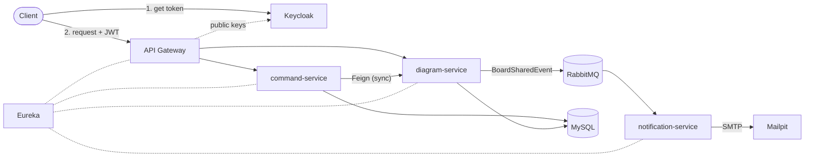
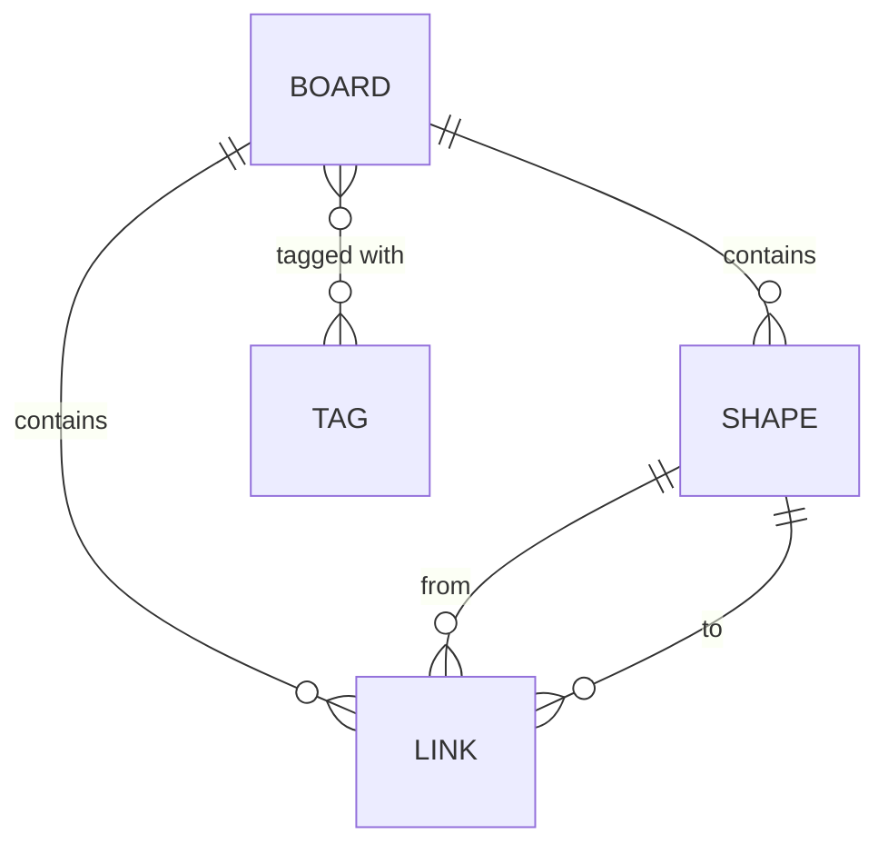
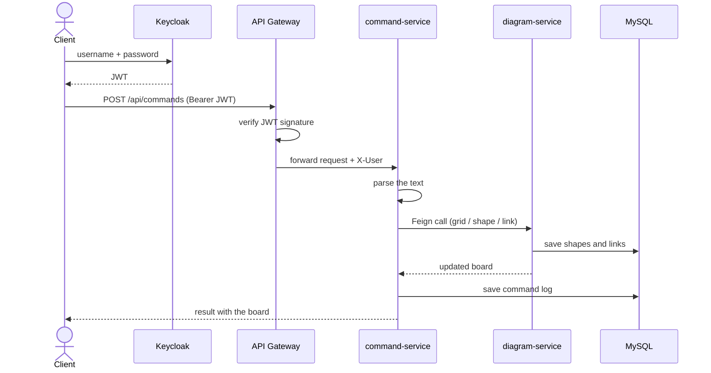
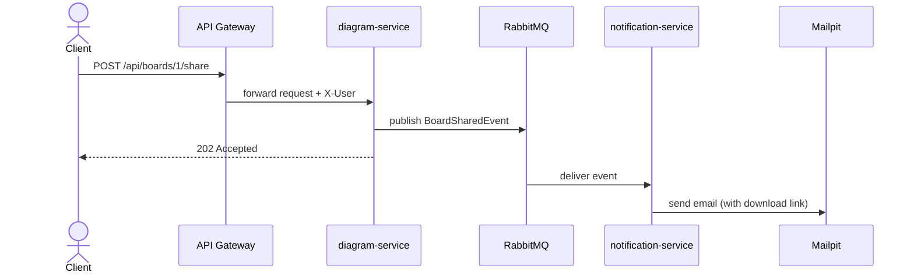

# BoxDrawer

Draw diagrams by describing them in plain language. Send a command such as
`draw a grid of 4 by 4 squares` or `map square 1 to square 6` and the board builds itself,
with shapes placed automatically. Boards can be tagged and shared by email.

The project is a set of Spring Boot microservices behind an API gateway, secured with Keycloak,
and started with a single Docker Compose command.

## Architecture



| Service              | Port | Role                                                                                |
| -------------------- | ---- | ----------------------------------------------------------------------------------- |
| eureka-server        | 8761 | Service registry                                                                    |
| api-gateway          | 8080 | Single entry point: validates the JWT and routes requests (`lb://`)                 |
| diagram-service      | 8081 | Boards, shapes, links and tags. Automatic layout. Publishes events                  |
| command-service      | 8082 | Turns text commands into actions and calls diagram-service. Keeps a command history |
| notification-service | 8083 | Consumes events from RabbitMQ and sends emails                                      |

Infrastructure (Docker): MySQL (`diagram_db`, `command_db`), Keycloak, RabbitMQ, Mailpit.
Only the gateway is exposed for the API; the services have no published port.

## Data model

`diagram-service` (database `diagram_db`):



`command-service` (database `command_db`) has one table, `command_logs`, storing each command, its
interpreted action and its status. Schemas are created by Flyway migrations
(`src/main/resources/db/migration`).

## How it works

### Running a command



### Sharing a board



### Security

- Keycloak (realm `boxdrawer`) issues the JWT.
- The gateway checks the token signature with Keycloak's public keys; it does not call Keycloak on each request.
- The gateway copies the username from the token into an `X-User` header. It is used as the board owner and as the sender name in share emails.
- Sharing stores a random UUID v4 token (`share_tokens` table). The email links to `/api/shared/{token}`, which needs no JWT and works once: the first download marks it used, later calls get `410 Gone`.

## Project structure

```
boxdrawer/
├── docker-compose.yml
├── docker/
│   ├── mysql/init.sql                  # creates diagram_db and command_db
│   └── keycloak/realm-boxdrawer.json   # realm, client and demo user
├── eureka-server/
├── api-gateway/
├── diagram-service/                    # entity, repository, dto, mapper, service, controller, event
├── command-service/                    # parser, client (Feign), service, controller
├── notification-service/               # RabbitMQ listener + email
├── demo.sh
└── requests.http
```

Each service is an independent Maven project with its own `Dockerfile`.

## Run

Requirements: Docker with Docker Compose.

```bash
docker compose up --build
```

The first start takes a few minutes. Wait about a minute after the logs calm down so that every
service shows up in Eureka (http://localhost:8761), then run the demo:

```bash
./demo.sh
```

You can also use `requests.http` (VS Code REST Client or IntelliJ) or Postman.

### Get a token manually

```bash
curl -s -X POST http://localhost:8180/realms/boxdrawer/protocol/openid-connect/token \
  -d grant_type=password -d client_id=boxdrawer-client -d username=demo -d password=demo
```

Use the `access_token` value as `Authorization: Bearer <token>`.

### Useful URLs

| What             | URL                    | Login         |
| ---------------- | ---------------------- | ------------- |
| API (gateway)    | http://localhost:8080  | JWT           |
| Eureka dashboard | http://localhost:8761  | -             |
| Keycloak admin   | http://localhost:8180  | admin / admin |
| RabbitMQ UI      | http://localhost:15672 | guest / guest |
| Mailpit (emails) | http://localhost:8025  | -             |
| MySQL            | localhost:3306         | root / root   |

API user: `demo` / `demo` (client `boxdrawer-client`).

## API

All paths go through the gateway and need a Bearer token, except `GET /api/shared/{token}`.

| Method | Path                              | Body                                                   |
| ------ | --------------------------------- | ------------------------------------------------------ |
| POST   | `/api/boards`                     | `{"name":"..."}`                                       |
| GET    | `/api/boards`, `/api/boards/{id}` |                                                        |
| DELETE | `/api/boards/{id}`                |                                                        |
| POST   | `/api/boards/{id}/shapes`         | `{"type":"square","color":"red","label":"x"}`          |
| POST   | `/api/boards/{id}/grid`           | `{"type":"square","rows":4,"cols":4}`                  |
| POST   | `/api/boards/{id}/links`          | `{"fromSeq":1,"toSeq":6,"label":"x"}`                  |
| POST   | `/api/boards/{id}/tags/{name}`    |                                                        |
| POST   | `/api/boards/{id}/share`          | `{"email":"a@b.c"}`                                    |
| GET    | `/api/boards/{id}/export`         | downloads the board as a `.excalidraw` file            |
| GET    | `/api/shared/{token}`             | public, one-time link from the share email             |
| POST   | `/api/commands`                   | `{"boardId":1,"text":"draw a grid of 4 by 4 squares"}` |
| GET    | `/api/commands?boardId=1`         | command history                                        |

Shape types: `square`, `circle`, `triangle`. Shapes are numbered per board (1, 2, 3...).

## Commands

| Command                                     | Result                                   |
| ------------------------------------------- | ---------------------------------------- |
| `draw a grid of 4 by 4 squares`             | Creates 16 squares laid out in a grid    |
| `add a red circle labeled start`            | Adds one shape with a color and a label  |
| `map square 1 to square 6 label depends on` | Draws a link between shape 1 and shape 6 |

Commands never contain coordinates or sizes: positions are computed automatically by diagram-service.
Words such as `link`, `connect` and `map` are interchangeable, and colors are optional.

## Troubleshooting

- `503` right after startup: the services are not registered in Eureka yet. Wait a few seconds.
- `401` with a token: the token expired (1 hour), or Keycloak was not ready yet. Get a new token.
- Rebuild one service: `docker compose up --build diagram-service`.
- Reset the databases: `docker compose down -v`.
